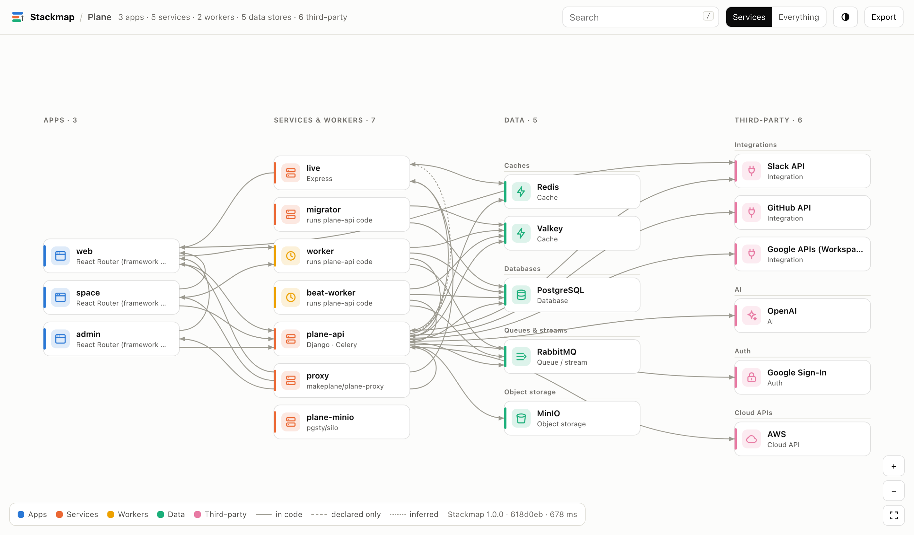
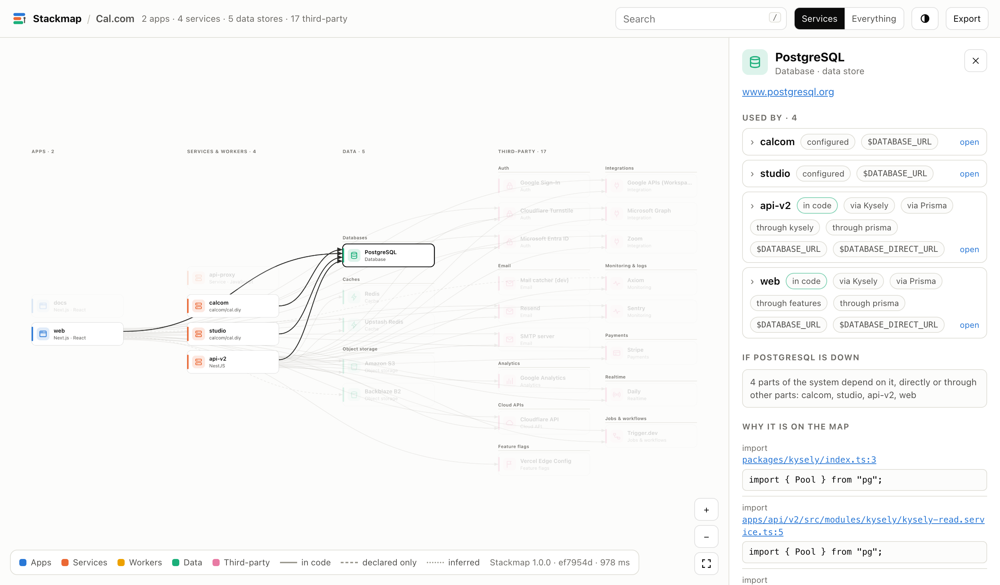
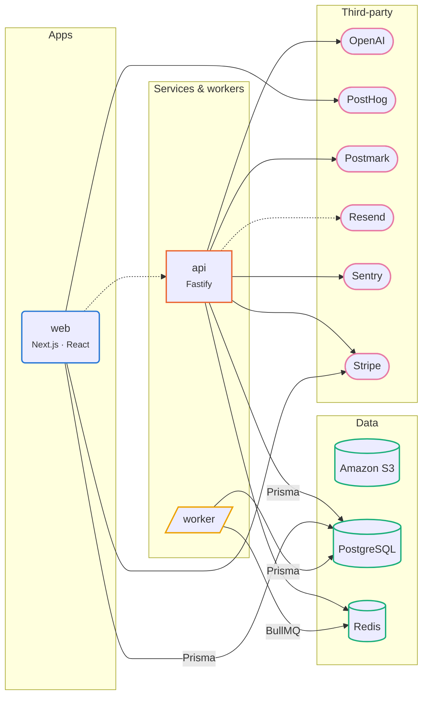

<div align="center">


# Stackmap

**The architecture diagram that draws itself from your code, and shows its work.**

Every service, database, queue and third-party API in your repo, on one map.<br>
Every box and arrow links to the exact line of code that put it there.

[](https://github.com/AnshumaanSinghh/Stackmap/actions/workflows/ci.yml)
[](https://www.npmjs.com/package/stackmap-cli)
[](package.json)
[](LICENSE)

[**Live examples**](https://anshumaansinghh.github.io/Stackmap/#gallery) · [Quick start](#quick-start) · [GitHub Action](#review-architecture-changes-in-pull-requests) · [For AI agents (MCP)](#give-your-ai-agent-a-map) · [Docs](docs/)

</div>

<picture>
  <source media="(prefers-color-scheme: dark)" srcset="docs/images/hero-dark.png">
  
</picture>

<p align="center"><sub>The map of <a href="https://github.com/makeplane/plane">Plane</a>, generated from its code in under a second. <a href="https://anshumaansinghh.github.io/Stackmap/gallery/plane.html">Open it live</a>.</sub></p>

## Quick start

```bash
npx stackmap-cli
```

Run it at the root of any project. You get a summary in the terminal and an interactive map in your browser:

```text
  Stackmap · acme  135 ms · 24 files

  Apps        web (Next.js)
  Services    api (Fastify), worker
  Data        Amazon S3, PostgreSQL, Redis
  Third-party OpenAI, PostHog, Postmark, Resend, Sentry, Stripe

  web    → PostHog · Stripe · api · PostgreSQL via Prisma
  api    → OpenAI · PostgreSQL via Prisma · Postmark · Redis · Resend? · Sentry · Stripe
  worker → Redis via BullMQ · PostgreSQL via Prisma
```

No account, no API key, no AI, nothing uploaded. One command, zero dependencies, usually under a second.

## Why Stackmap

Architecture diagrams go stale the week they are drawn. The real picture lives in `package.json` files, `docker-compose.yml`, `.env.example`, Terraform and a thousand `import` lines. Stackmap reads all of it and draws the system as it actually is today:

- **Apps, services and workers.** Every deployable unit in a monorepo, classified as an app, API, worker or CLI from its frameworks and how it runs.
- **Databases, caches, queues, storage and search.** From drivers and ORMs (Prisma, Drizzle, SQLAlchemy, Active Record ...), compose images, connection URLs and infrastructure code.
- **Every third-party API.** Stripe, OpenAI, Sentry, Twilio, Slack and 200+ more, from SDK imports, env vars and even raw `fetch("https://api.stripe.com/...")` calls.
- **Who talks to whom.** Service to service, service to database, service to API, including connections hidden behind internal libraries ("web uses PostgreSQL through `packages/db`").

### Every box has a receipt

LLM-drawn diagrams guess. Stackmap only draws what it can prove, and shows you the proof. Click anything to see the files and lines behind it, with a link to the line on GitHub, and what breaks if it goes down.

<picture>
  <source media="(prefers-color-scheme: dark)" srcset="docs/images/evidence-dark.png">
  
</picture>

Arrows say how sure they are: **solid** means the code imports or calls it, **dashed** means it is declared in a manifest but never imported (often a dependency you can delete), **dotted** means it was inferred from naming, such as an `API_URL` env var.

## Keep a live diagram in your README

```bash
npx stackmap-cli readme
```

Stackmap writes a [Mermaid](https://mermaid.js.org/) diagram between two markers in your `README.md`. GitHub, GitLab and most docs sites render it natively, and it only changes when your architecture does. Here is the diagram for the example project in [`test/fixtures/saas`](test/fixtures/saas):



Add `npx stackmap-cli readme --check` to CI and the build fails when someone changes the architecture without updating the diagram.

## Review architecture changes in pull requests

The GitHub Action comments on every pull request that changes how your system is wired, with a diagram of just the change:

```yaml
# .github/workflows/stackmap.yml
name: Stackmap
on: pull_request
permissions:
  contents: read
  pull-requests: write
jobs:
  map:
    runs-on: ubuntu-latest
    steps:
      - uses: actions/checkout@v7
      - uses: AnshumaanSinghh/Stackmap@v1
```

A pull request that adds the Anthropic SDK and drops PostHog gets this comment:

> ### Stackmap: architecture changes
>
> **New third-party services**
>
> - **Anthropic** (AI), used by web · `apps/web/src/lib/ai.ts:1`
>
> > Data may now be sent to Anthropic. If personal data is involved, check your privacy policy and subprocessor list.
>
> **Removed**
>
> - **PostHog** (Analytics) is no longer used

New databases, new service-to-service calls and new third-party data flows stop slipping through code review unnoticed. Pull requests that change nothing architectural get no comment. More options, including job summaries and README checks, are in [docs/github-action.md](docs/github-action.md).

## Enforce architecture rules

Write the rules your team already has in its head, and let CI hold the line:

```json
{
  "rules": [
    { "deny": "kind:app -> category:database", "message": "Frontends go through the API" },
    { "deny": "* -> category:ai", "except": "api", "message": "Only the API may call AI providers" },
    { "require": "kind:service -> Sentry", "message": "Every service reports errors" }
  ]
}
```

Save that as `.stackmap.json` and run `npx stackmap-cli check`. Violations exit non-zero and, in GitHub Actions, are annotated on the line that caused them. Rules see through internal libraries, so a frontend that reaches the database through a shared package still counts. See [docs/rules.md](docs/rules.md).

## Give your AI agent a map

`stackmap mcp` is a [Model Context Protocol](https://modelcontextprotocol.io) server. It gives Claude Code, Cursor, Windsurf and other agents a structured, evidence-backed view of the system before they change it:

```bash
claude mcp add stackmap -- npx -y stackmap-cli mcp
```

```json
{ "mcpServers": { "stackmap": { "command": "npx", "args": ["-y", "stackmap-cli", "mcp"] } } }
```

| Tool | What the agent gets |
|---|---|
| `stackmap_overview` | Every app, service and worker, what each talks to, env vars and deploy targets |
| `stackmap_lookup` | One component: who uses it, what it uses, the file:line behind each link |
| `stackmap_impact` | Everything that depends on a component, directly or indirectly |
| `stackmap_diff` | Architecture changes since a git ref |
| `stackmap_check` | Rule violations, with locations |

Prefer plain files? `npx stackmap-cli -f md -o STACK.md` writes an inventory that works well as agent context and as onboarding docs.

## How it compares

| | Stackmap | Hand-drawn diagrams | Diagrams as code | AI diagram generators | Import graphs |
|---|:-:|:-:|:-:|:-:|:-:|
| Draws itself from the code | ✓ | ✗ | ✗ | ✓ | ✓ |
| Services, databases, queues and third-party APIs | ✓ | ✓ | ✓ | partly | ✗ (files and modules) |
| Links every box and arrow to the code behind it | ✓ | ✗ | ✗ | ✗ | ✓ |
| Same code, same diagram (deterministic) | ✓ | n/a | ✓ | ✗ | ✓ |
| Code never leaves your machine | ✓ | ✓ | ✓ | usually sent to an LLM | ✓ |
| Fails CI when the diagram drifts | ✓ | ✗ | ✗ | ✗ | ✓ |
| Comments architecture changes on pull requests | ✓ | ✗ | ✗ | ✗ | ✗ |

Stackmap does not replace a whiteboard for systems that do not exist yet, or a module graph when you are refactoring code inside one service. It answers the question new teammates, reviewers and auditors actually ask: *what is this system made of, and what does it talk to?*

## What it understands

| | |
|---|---|
| **Languages** | JavaScript and TypeScript (npm, pnpm, Yarn, Bun workspaces), Python (pyproject, uv, Poetry, requirements, Pipfile), Go, Rust, Ruby, PHP, Java and Kotlin (Maven, Gradle, version catalogs), C# and .NET, Elixir |
| **Infrastructure** | docker-compose (with overrides), Dockerfiles, Kubernetes manifests, Terraform, Cloudflare Wrangler bindings, Render blueprints, `.env.example` files |
| **Hosting** | Vercel, Netlify, Cloudflare Workers, Fly.io, Railway, Render, Heroku, Firebase, AWS (SAM, CDK, SST, Serverless), Kubernetes, Docker |
| **Database config** | Prisma, Drizzle, Django, Rails `database.yml`, Spring `application.properties`, Laravel, TypeORM, Knex |
| **Technologies** | 500+ databases, queues, SaaS APIs, frameworks and clients, each [verified against its package registry](scripts/verify-catalog.js) |

Tested on 16 well-known open-source codebases, including Cal.com, Plane, Mastodon, Immich, Twenty, Langfuse, Chatwoot and Gitea. Browse the results in the [gallery](https://anshumaansinghh.github.io/Stackmap/#gallery).

## Commands

```text
stackmap [path]                 Map the project and open the interactive map
stackmap readme [path]          Keep a Mermaid diagram in README.md up to date
stackmap diff <base> [path]     Architecture changes since a git ref (or a saved .json)
stackmap check [path]           Enforce the rules in .stackmap.json (exits 1 on violations)
stackmap why <name> [path]      Show why something is on the map, with file:line evidence
stackmap mcp [path]             Run as an MCP server for AI coding agents (stdio)

-f, --format <fmt>    html (default), svg, mermaid, md, json, dot
-o, --out <file>      Write output to a file ("-" for stdout)
    --libraries       Draw internal libraries instead of folding them into their users
```

A few things people do with it:

```bash
npx stackmap-cli why stripe              # every place Stripe is used, line by line
npx stackmap-cli diff origin/main        # what this branch changes in the architecture
npx stackmap-cli -f svg -o docs/arch.svg # a static image for docs and slides
npx stackmap-cli -f json > stack.json    # the full graph, for your own tooling
```

Fix anything it gets wrong in [`.stackmap.json`](docs/config.md): add services it cannot see, rename nodes, hide noise, or teach it your internal SDKs.

## Privacy

Stackmap runs entirely on your machine and makes no network requests. It never reads `.env` or other secret files, only `.env.example`-style templates, and from those it keeps variable names, URL schemes and host names, never values. The generated HTML is a single self-contained file with no external scripts.

## Contributing

The most useful contribution takes about a minute: if Stackmap missed a database, queue or API your project uses, add it to [`src/catalog/data.js`](src/catalog/data.js) and run `npm test`. See [CONTRIBUTING.md](CONTRIBUTING.md). Bug reports with a small reproduction (a `package.json` and a file or two) are gold.

## License

[MIT](LICENSE) © Anshumaan Singh
